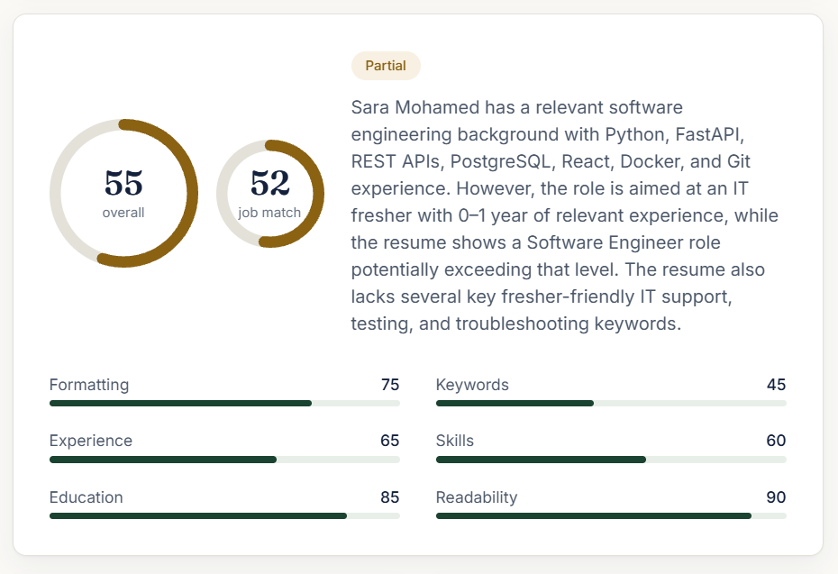
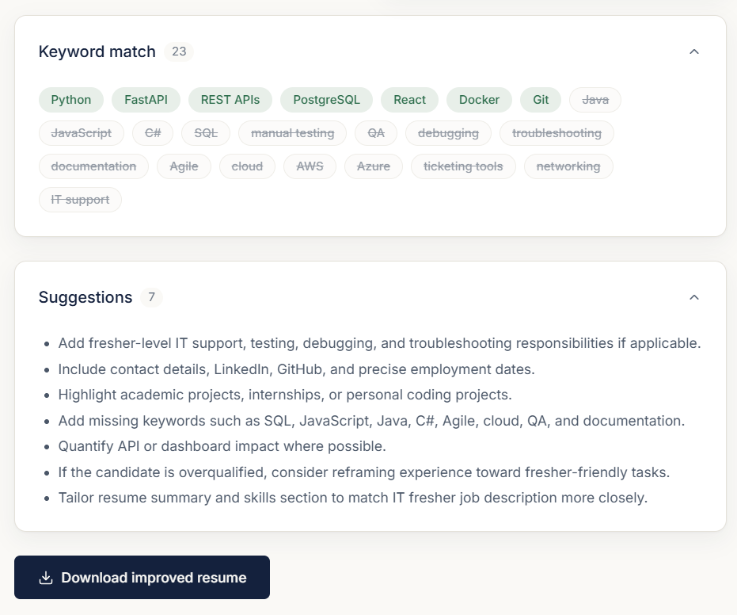

# ResumeIQ

[](https://github.com/M-249S/resumeiq/actions/workflows/backend-ci.yml)
[](https://github.com/M-249S/resumeiq/actions/workflows/frontend-ci.yml)

AI-powered ATS resume analyzer and optimizer. Upload a PDF resume (and optionally a job description) to get an ATS score, a job-match score, strengths and weaknesses, missing keywords, an AI-rewritten resume, and a tailored cover letter. Every analysis is saved to a per-user history, so you can watch your score improve over time.

**Live app:** https://resumeiq-amber.vercel.app
**Try it without an account:** https://resumeiq-amber.vercel.app/try (rate limited, 2 MB PDFs)

> The backend runs on a free Render instance, so the first request after a period of inactivity can take about a minute while the service wakes up.





---

## Features

- **ATS analysis**: overall score, job-match score, and per-category scores (formatting, keywords, experience, skills, education, readability)
- **Works with or without a job description**: without one, the match score is left out instead of showing a misleading 0
- **Keyword match**: which job-description keywords the resume covers and which are missing
- **Strengths, weaknesses and suggestions** specific to the resume
- **AI resume rewrite**: download an improved resume as PDF
- **AI cover letter** tailored to the job description: editable in the browser, downloadable as `.docx`
- **Analysis history with progress**: reopen or delete past analyses, see the score change between versions of the same resume, and a progress chart
- **Guest demo**: try one analysis without signing up, protected by per-IP rate limits, size caps and a daily budget
- **Accounts**: email and password, or Google sign-in, with JWT authentication
- **Privacy controls**: delete your account and all of your data yourself from Settings
- **Resilient AI layer**: retries on rate limits, optional fallback models, and a clean "try again" response instead of a crash

---

## Architecture

```
┌────────────────────┐   HTTPS / JSON   ┌────────────────────┐        ┌───────────────┐
│  React + TypeScript│ ───────────────▶ │  FastAPI backend   │ ─────▶ │  PostgreSQL   │
│  (Vercel)          │                  │  (Docker, Render)  │        │  (Neon)       │
└────────────────────┘                  └─────────┬──────────┘        └───────────────┘
                                                  │
                                                  ▼
                                        OpenRouter (OpenAI-compatible API)
```

---

## Tech stack

**Backend**
- Python 3.12, FastAPI, Pydantic
- SQLAlchemy 2, Alembic migrations, PostgreSQL (psycopg 3)
- JWT authentication (python-jose, passlib/bcrypt), Google sign-in (ID token verification)
- slowapi rate limiting on the AI endpoints
- AI via OpenRouter using the `openai` SDK
- PyPDF (PDF parsing), ReportLab (PDF output), python-docx (cover letter `.docx`)

**Frontend**
- React 19, TypeScript, Vite
- Tailwind CSS 4
- React Router, Zustand, Axios
- oxlint

**DevSecOps**
- Docker image running as a non-root user, with a health check
- Backend deployed on Render (`render.yaml`), frontend on Vercel, database on Neon serverless Postgres
- GitHub Actions CI for both halves of the app, Dependabot for dependency updates, branch protection on `main` (details below)

---

## CI/CD and security

Every pull request runs two workflows, and all checks are required to merge into `main`.

**Backend CI** (`.github/workflows/backend-ci.yml`)

| Job | What it checks |
|---|---|
| Lint | flake8 |
| Test | pytest |
| SAST | Bandit (medium severity and above) |
| Secret scan | Gitleaks |
| Dependency scan | Trivy filesystem scan of the pinned Python dependencies |
| Docker build and scan | Builds the image and scans it with Trivy |

**Frontend CI** (`.github/workflows/frontend-ci.yml`)

| Job | What it checks |
|---|---|
| Type-check, Lint and Build | TypeScript, oxlint, production Vite build |
| Dependency Audit | `npm audit` for high and critical advisories in production dependencies |

Other practices:
- **Branch protection:** `main` only accepts pull requests whose required checks have passed.
- **Supply chain:** third-party GitHub Actions are pinned to commit SHAs, workflows run with least-privilege `permissions`, and dependencies are pinned.
- **Dependabot** opens grouped weekly update PRs for pip, npm, Docker and GitHub Actions. Each must pass the full pipeline before merging.
- **Secrets** are never committed. They are supplied through environment variables and the hosting dashboards.
- **Abuse protection:** per-IP rate limits and a per-user daily allowance on the AI endpoints, an explicit CORS allowlist, upload size and page caps, and a global daily budget on the guest demo.
- **Data lifecycle:** users can delete their account and data themselves, and database schema changes go through Alembic migrations applied automatically on container start.

---

## Project structure

```
backend/
  app/
    auth/         # JWT, register/login, Google sign-in, current-user dependency
    routers/      # health, resume, users
    services/     # AI client, analysis, cover letter, PDF/DOCX
    models/ db/   # SQLAlchemy models and session
    schemas/      # Pydantic schemas
  alembic/        # database migrations
  tests/          # pytest suite
  Dockerfile
  DEPLOY.md       # Render deployment notes
frontend/
  src/            # pages, components, services, state
render.yaml       # Render Blueprint (backend)
.github/          # CI workflows and Dependabot config
```

---

## API overview

| Method | Path | Description |
|---|---|---|
| GET | `/health` | Health check |
| POST | `/auth/register` | Create an account |
| POST | `/auth/login` | Log in (OAuth2 password form), returns a JWT |
| POST | `/auth/google` | Sign in with a Google ID token |
| GET | `/auth/me` | Current user |
| DELETE | `/users/me` | Delete your account and all of your data (requires confirming your email) |
| POST | `/resume/demo` | Guest analysis, no account needed (rate limited) |
| POST | `/resume/upload` | Analyze a PDF resume (optional job description) |
| POST | `/resume/improve` | AI-rewritten resume |
| POST | `/resume/download` | Download the improved resume as PDF |
| POST | `/resume/cover-letter` | Generate a cover letter |
| POST | `/resume/cover-letter/download` | Download the cover letter as `.docx` |
| GET | `/resume/history` | List your past analyses (`limit`, `offset`) |
| GET | `/resume/history/{id}` | Full details of one analysis |
| DELETE | `/resume/history/{id}` | Delete one analysis |

Interactive docs are served at `/docs` when running the backend.

---

## Run locally

**Prerequisites:** Python 3.12, Node.js, and a PostgreSQL database (a local one, or a free Neon project).

### Backend

```bash
cd backend
python -m venv .venv
# Windows: .venv\Scripts\activate    macOS/Linux: source .venv/bin/activate
pip install -r requirements.txt -r requirements-dev.txt
cp .env.example .env        # then fill in real values
alembic upgrade head
uvicorn app.main:app --reload
```

### Frontend

```bash
cd frontend
npm install
npm run dev
```

Set `VITE_API_URL` to the backend URL (for example `http://localhost:8000`) if it is not already configured. Google sign-in is optional and needs `VITE_GOOGLE_CLIENT_ID`.

### Tests and lint

```bash
cd backend
pytest -q
flake8 app/ tests/ --max-line-length=100 --extend-ignore=E501
bandit -r app/ -f screen --severity-level medium

cd ../frontend
npm run lint
npm run build
```

---

## Configuration

Backend environment variables (see `backend/.env.example`):

| Variable | Required | Purpose |
|---|---|---|
| `DATABASE_URL` | yes | PostgreSQL connection string (a bare `postgresql://` URL is accepted) |
| `SECRET_KEY` | yes | Signs JWT tokens |
| `CORS_ORIGINS` | yes (production) | Comma-separated list of allowed frontend origins |
| `OPENROUTER_API_KEY` | for real AI output | OpenRouter API key |
| `OPENROUTER_MODEL` | no | Primary model |
| `OPENROUTER_FALLBACK_MODELS` | no | Comma-separated models to try if the primary keeps failing |
| `OPENROUTER_RETRIES` | no | Attempts per model (default 2) |
| `GOOGLE_CLIENT_ID` | no | Enables Google sign-in (must match the frontend client ID) |
| `TRUST_PROXY_HEADERS` | no | Set to `1` behind a reverse proxy so rate limits use the real client IP |
| `DEMO_DAILY_LIMIT` | no | Guest demo analyses allowed per day (default 100) |
| `USER_DAILY_AI_LIMIT` | no | AI requests one signed-in account may make per UTC day (default 30) |

Without an AI key the analysis falls back to a simple built-in heuristic so the app still runs, but cover letters need a working AI provider. Deployment steps are in [`backend/DEPLOY.md`](backend/DEPLOY.md).

---

## Roadmap

- [x] Resume analysis, rewrite and cover letter generation
- [x] JWT authentication and Google sign-in
- [x] PostgreSQL (Neon) and Alembic migrations
- [x] Analysis history with score progress
- [x] Guest demo with abuse protection
- [x] Self-serve account and data deletion
- [x] Docker, CI/CD for backend and frontend, security scanning, branch protection
- [x] Deployment (Render, Vercel and Neon)
- [ ] Email verification and password reset (needs a verified sending domain)
- [ ] Frontend unit tests
- [ ] Per-user usage quotas and monitoring

---

## Author

**Mujahid Suliman Hamid Adam**
Software Engineer, MSc Information Technology

## License

MIT License
